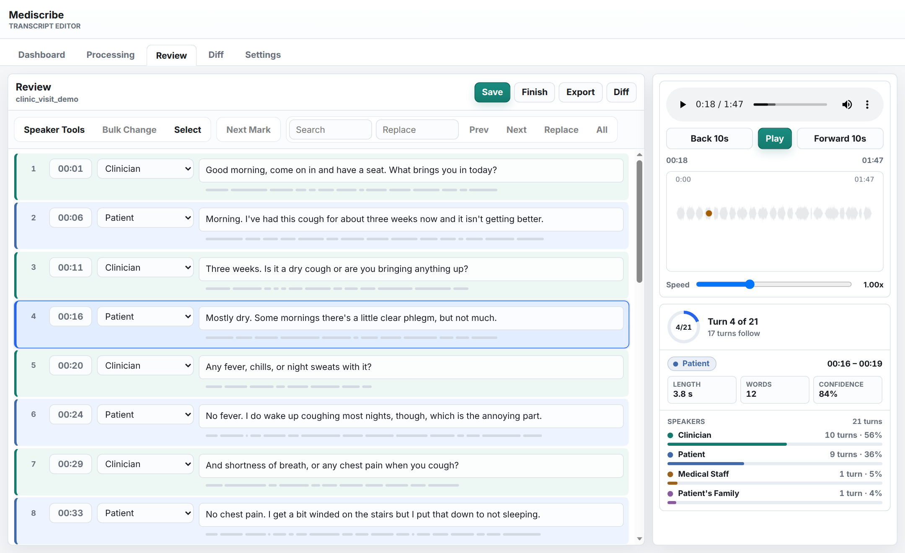
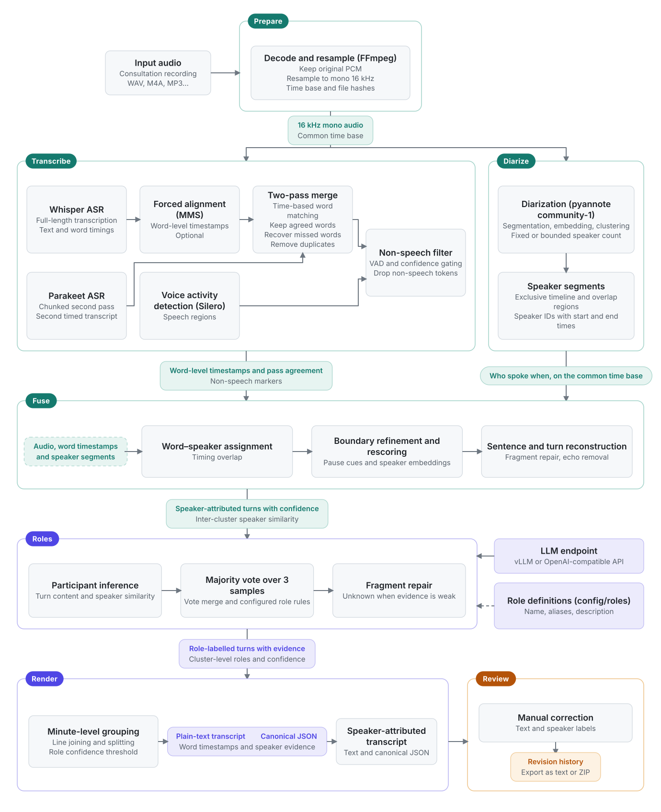

<div align="center">

# Mediscribe

**Speaker-attributed transcripts of clinical consultations.**

<p>
  
  
  
  
  
</p>

<a href="#pipeline">Pipeline</a> ·
<a href="#install">Install</a> ·
<a href="#run">Run</a> ·
<a href="#outputs">Outputs</a> ·
<a href="src/WebUI/README.md">User tutorial</a> ·
<a href="#authors">Authors</a>

<br><br>



<sub><i>Screenshots show a synthetic consultation written for demonstration, not a real recording.</i></sub>

</div>

Mediscribe transcribes recordings, identifies speakers, and assigns clinical
roles. The browser editor lets you listen, correct text and speaker labels,
and export the reviewed transcript.

| | |
|---|---|
| **Roles** | Defined in [config/roles/clinical.json](config/roles/clinical.json) |
| **Input** | WAV, M4A, MP3, FLAC, OGG, AAC, WebM, MP4, plus WMA through the CLI |
| **Audio models** | [Whisper](https://github.com/openai/whisper) turbo · [Parakeet-TDT](https://github.com/istupakov/onnx-asr) · [MMS alignment](https://pytorch.org/audio/) (non-commercial) · [Silero VAD](https://github.com/snakers4/silero-vad) · [pyannote](https://github.com/pyannote/pyannote-audio) |
| **LLM** | vLLM or a cloud service with OpenAI-compatible Chat Completions and Models APIs |

## Pipeline

<picture>
  <source media="(prefers-color-scheme: dark)" srcset="docs/pipeline-dark.svg">
  
</picture>

## Install

Use Linux with conda or mamba. An NVIDIA GPU is recommended for the audio
models. CPU processing is also supported.

```bash
git clone <repo-url> Mediscribe-core
cd Mediscribe-core
conda env create -f environment.yml
HF_TOKEN=hf_... conda run -n scribe python scripts/download_models.py
```

Accept the terms for
[pyannote/speaker-diarization-community-1](https://huggingface.co/pyannote/speaker-diarization-community-1)
before downloading, and supply a Hugging Face read token through `HF_TOKEN`.

Configure your LLM endpoint in a `.env` file at the repository root:

```dotenv
MEDISCRIBE_LLM_BASE_URL=https://api.example.com/v1
MEDISCRIBE_LLM_MODEL=your-model-name
MEDISCRIBE_LLM_API_KEY=your-api-key
```

For vLLM, use the URL and model name exposed by your server. Leave the API
key empty if the server allows unauthenticated requests.

## Run

```bash
./scripts/webui.sh
```

Open the URL printed by the launcher, then choose **Import**,
**Run Selected**, and **Review**.

The CLI accepts files or directories. With no path, it uses `data/input/`
and creates the folder if needed:

```bash
./scripts/run.sh
./scripts/run.sh visit.m4a
./scripts/run.sh visit.m4a follow_up.wav
./scripts/run.sh recordings/
./scripts/run.sh visit.m4a --keep-intermediate --debug-json
./scripts/run.sh data/input --resume
./scripts/run.sh data/input --num-speakers 2
./scripts/run.sh --help
```

The editor opens CLI results from `data/output/`. If the audio is not in
`data/input/`, keep intermediate files so that playback works. If an LLM
request fails, the audio results are saved. Use `--resume` or **Resume** to
continue.

| CLI option | Purpose |
|------------|---------|
| `-h`, `--help` | Show all options |
| `--output-root DIR` | Transcript storage, default `data/output` |
| `--intermediate-root DIR` | Working files, default `data/intermediate` |
| `--whisper-model NAME` | Whisper model, default `turbo` |
| `--language CODE` | Spoken language, default `en` |
| `--device DEVICE` | Audio device, default CUDA when available, otherwise CPU |
| `--num-speakers N` | Exact speaker count |
| `--min-speakers N` | Minimum speaker count, default `2` |
| `--max-speakers N` | Maximum speaker count, default `5` |
| `--keep-intermediate` | Keep working files for the editor |
| `--debug-json` | Write additional debugging JSON |
| `--resume` | Reuse audio results from a previous run |
| `--no-forced-align` | Use Whisper word timings |
| `--no-rescore` | Skip voice embedding rescoring |
| `--low-confidence-threshold VALUE` | Minimum role confidence, default `0.45` |
| `--llm-base-url URL` | Override the API base URL |
| `--llm-model NAME` | Override the endpoint model |
| `--llm-timeout-sec N` | Request timeout, default `1800` seconds |
| `--llm-concurrency N` | Concurrent recordings in the LLM stage, default `2` |
| `--serial` | Process recordings sequentially |

## Configuration

Launchers read `.env`, which is excluded from Git. CLI flags can override
the endpoint URL and model with `--llm-base-url` and `--llm-model`.

| Setting | Default | Purpose |
|---------|---------|---------|
| `MEDISCRIBE_LLM_BASE_URL` | required | API base URL, including its version path |
| `MEDISCRIBE_LLM_MODEL` | required | Model name accepted by the endpoint |
| `MEDISCRIBE_LLM_API_KEY` | empty | API authentication |
| `MEDISCRIBE_ROLES_CONFIG` | `config/roles/clinical.json` | Role definitions and assignment rules |
| `MEDISCRIBE_MODEL_CACHE` | library defaults | Audio-model cache directory |
| `MEDISCRIBE_CONDA_ENV` | `scribe` | Pipeline environment. `PYTHON_BIN` selects an interpreter directly |
| `MEDISCRIBE_LLM_CONCURRENCY` | `2` | Concurrent recordings in the LLM stage |
| `MEDISCRIBE_WORKER_IDLE_SEC` | `0` | Seconds before unloading idle audio models. `0` keeps them loaded |
| `MEDISCRIBE_CPU_RESERVE` | `4` | CPU cores reserved for other processes |
| `MEDISCRIBE_CPU_NICE` | `10` | Audio-worker scheduling priority. `0` keeps the current priority |

Edit [config/roles/clinical.json](config/roles/clinical.json) to change role labels, descriptions,
and assignment instructions. `required_roles` lists roles expected in every
recording. `ordered_roles` distinguishes similar participants by first
appearance. Both lists can be empty. Each role has a `name`, `aliases`, and
`description`. `Unknown` is included automatically. Restart the editor after changes.
See the [role configuration guide](config/roles/README.md) for field descriptions.

Editable word lists live in [config/lexicons/](config/lexicons/README.md).

## Outputs

```text
data/output/<name>/
  <name>_aligned_transcript.txt
  <name>_canonical.json
  <name>_revisions.jsonl
  <name>_revision_snapshots.json
data/intermediate/<name>/
```

The text transcript groups speech into minute blocks. The canonical JSON
contains word timings, speaker assignments, and role decisions. Editor
changes are recorded in the revision files.

## Move recordings between machines

A bundle is a ZIP file with recordings, their audio, working files,
transcripts, and review history. Use bundles to process recordings on one
machine and review them on a different machine, or to continue a review
on a different machine.

```bash
python3 src/bundle.py export --all -o visits.zip        # all processed recordings
python3 src/bundle.py export visit follow_up -o two.zip # recordings by name
python3 src/bundle.py import visits.zip                 # --replace overwrites
```

In the editor, **Import** accepts audio files and bundles. **Export Bundle**
saves open edits, then downloads the selected recordings as one bundle. If a
recording is already on the machine, the editor asks before it replaces the
local copy. A ZIP of a `data/` folder also imports. The bundle command needs
only the Python standard library.

## Authors

| Name | Role |
|------|------|
| **Bill Liu** | Author |
| **Lexi Yang** | Author |
| **Chuan Hong** | Supervisor |

Cite this repository with [CITATION.cff](CITATION.cff).

Released under the [MIT License](LICENSE).
