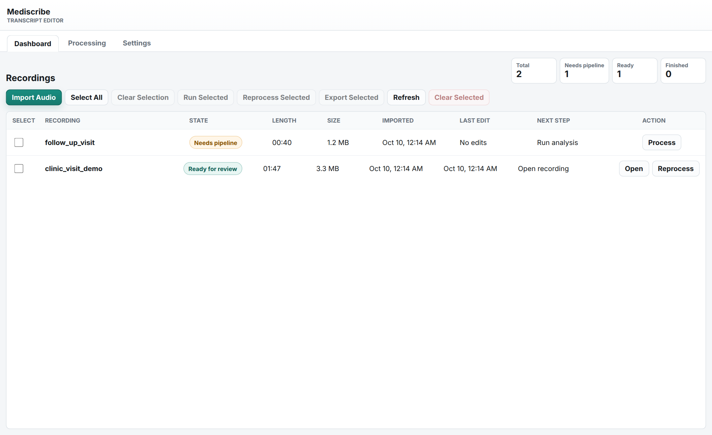
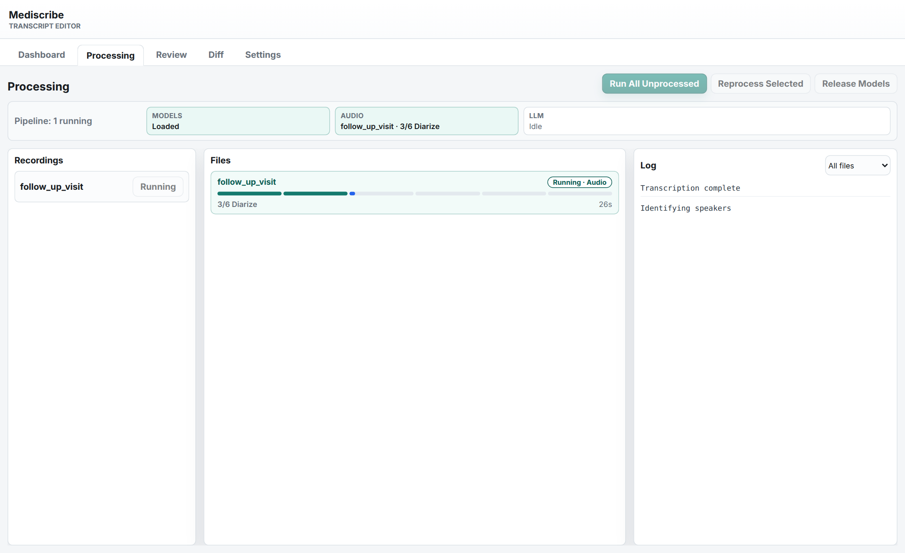
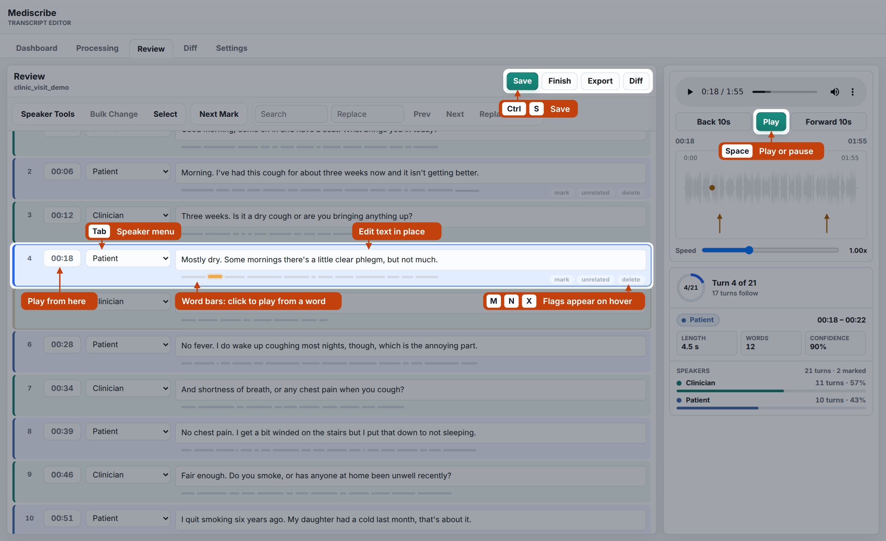
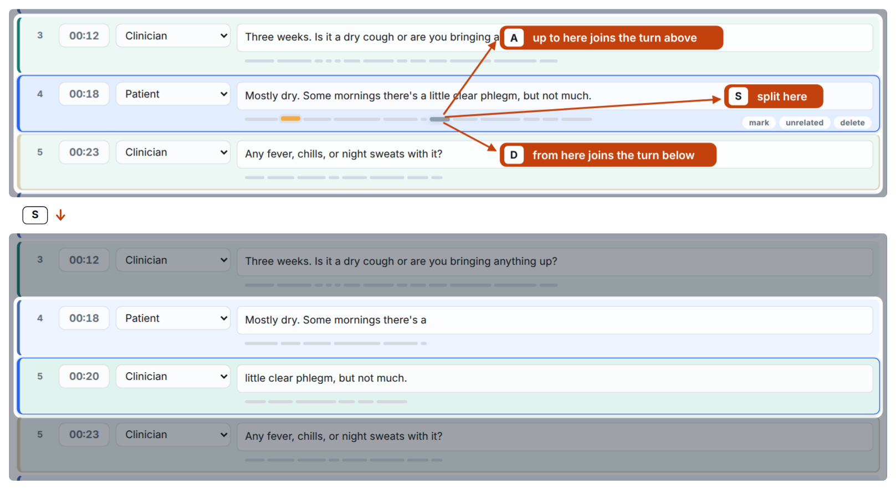
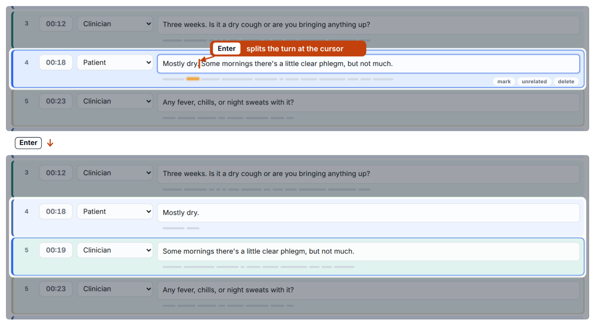
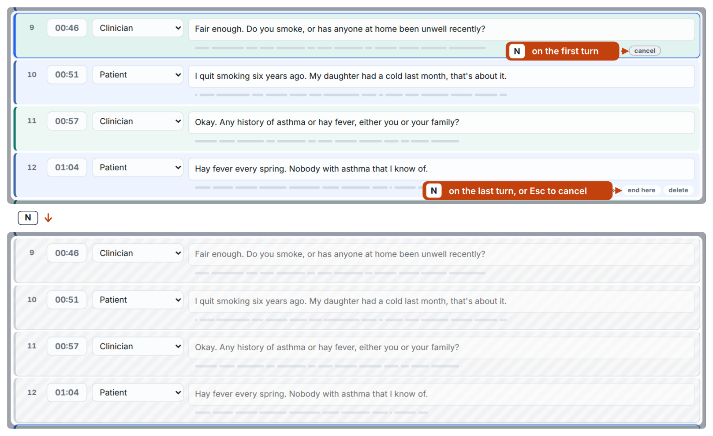
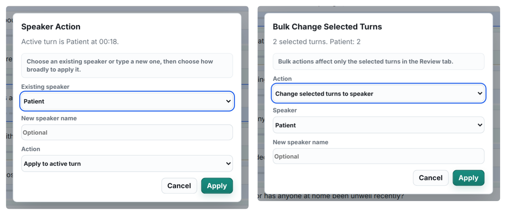
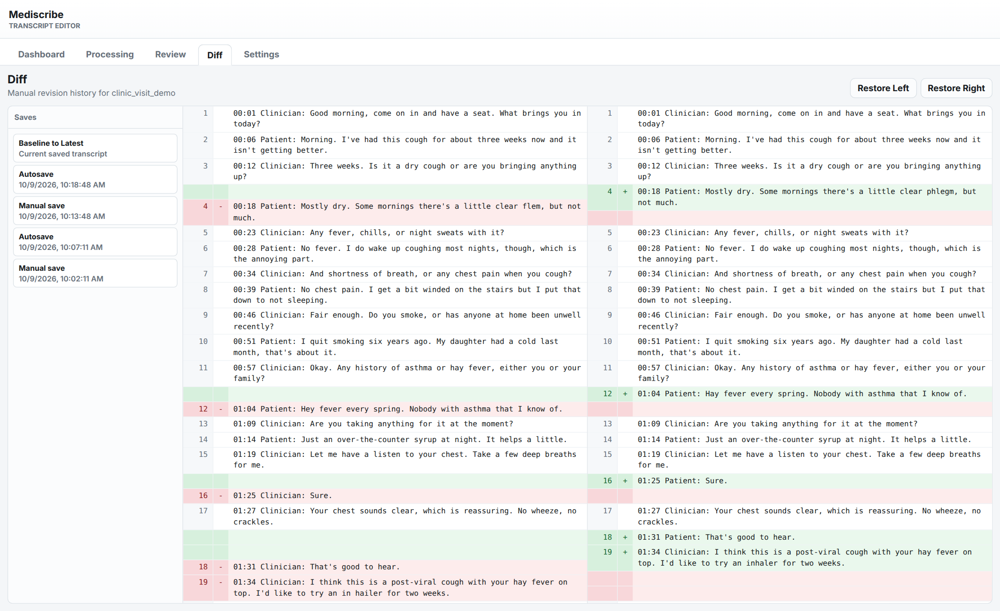

# Mediscribe user tutorial

Review transcripts while listening to the recording. Import audio, run the
pipeline, correct text and speaker labels, and export the result.

## Run

Configure the LLM endpoint in `.env` as described in the
[root README](../../README.md#install), then start the editor:

```bash
./scripts/webui.sh
```

Open the printed URL. The default port is 7860. The server chooses another
if it is occupied. Set `WEBUI_PORT` to prefer a different port, or pass
`--strict-port` to require it. The editor binds to the loopback interface.

The server uses Python's standard library. Audio processing uses the
`scribe` environment from `environment.yml`. Set `MEDISCRIBE_CONDA_ENV`
to use another environment, or `PYTHON_BIN` to select an interpreter.
`--project-root DIR` stores recordings and results under `DIR/data`.
Run `./scripts/webui.sh --help` to see all server options.

## Recordings and processing

**Dashboard** lists imported recordings and processed sessions. Select
recordings to run, reprocess, export, or remove them.

<p align="center">
  
</p>

**Processing** shows each recording's progress, model availability, and
logs. Click a recording to filter the log. **Release Models** unloads idle
audio models. The next run loads them again.

<p align="center">
  
</p>

Audio models stay loaded between recordings. Audio processing runs one
recording at a time. LLM requests can overlap with the next recording's
audio stages. Set `MEDISCRIBE_LLM_CONCURRENCY` to adjust concurrency and
`MEDISCRIBE_WORKER_IDLE_SEC` to unload models after an idle period.

The editor connects to the configured LLM endpoint before processing.
Use a vLLM server or a cloud service with OpenAI-compatible Chat Completions
and Models APIs. `--llm-base-url` and `--llm-model` override the URL and model.
`MEDISCRIBE_LLM_API_KEY` supplies authentication.

## Review

<p align="center">
  
</p>

Each turn shows its start time, speaker, text, and word timings. The current
word is highlighted during playback. **Settings** controls playback,
scrolling, autosave, and optional merge buttons, which are hidden by default.
`Tab` cycles speakers outside text fields. `Shift+Tab` cycles backward.

<p align="center">
  
</p>

Select and drag word bars to move them between turns.

<p align="center">
  
</p>

`Shift+Enter` splits a line within the turn. `Backspace` at the start of a
line merges it with the previous turn.

<p align="center">
  
</p>

Press `N` within a marked section to clear it. `X` selects the start and end
of a span to delete. Review the selection before confirming. `Ctrl+Z` undoes
the deletion.

<p align="center">
  
</p>

**Speaker Tools** adds or renames labels. **Bulk Change** edits selected turns.

- `M` bookmarks a turn. **Next Mark** and **Only Marks** help navigate bookmarks.
- `Ctrl+S` saves. `Ctrl+Z` and `Ctrl+Y` undo and redo. `Space` toggles playback
  outside text fields. `Q` and `E` play adjacent turns. `W` selects a turn.

Automatic assignment and the speaker menus use
[config/roles/clinical.json](../../config/roles/clinical.json). Edit the role definitions and
rules there, or set `MEDISCRIBE_ROLES_CONFIG` to another file. Restart the
editor to load the changes.

## Sessions and exports

The editor loads sessions from `data/intermediate/` and `data/output/`, using
saved editor state, pipeline JSON, or the final text transcript. Run the CLI
with `--keep-intermediate --debug-json` to retain audio and word timings for review.

**Save** writes editor state, the text transcript, and revision history.
**Finish** marks review complete. **Export** downloads one transcript.
**Export Selected** downloads a ZIP archive. The canonical pipeline JSON is
preserved.

**Diff** lists each manual save and autosave. Select one to compare the
transcript before and after it, or select **Baseline to Latest** to compare
the pipeline output with the current save. Removed lines are red and added
lines are green. **Restore Left** or **Restore Right** loads that version
into the editor. Autosave checkpoints are recorded at the interval set in
**Settings**, 5 minutes by default.

<p align="center">
  
</p>
